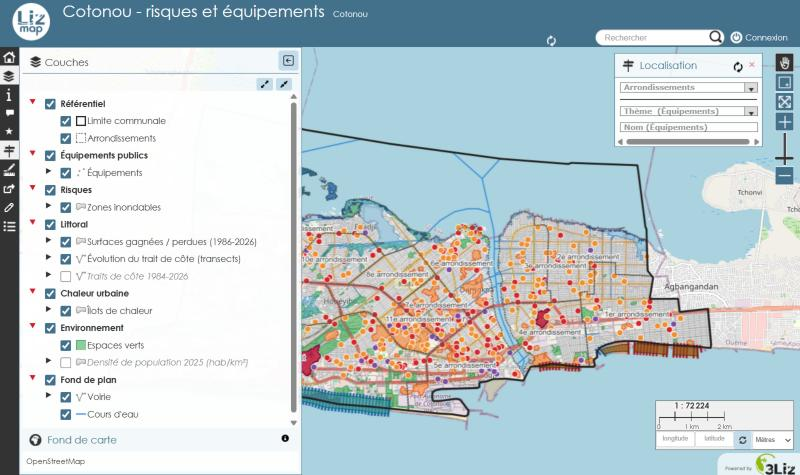
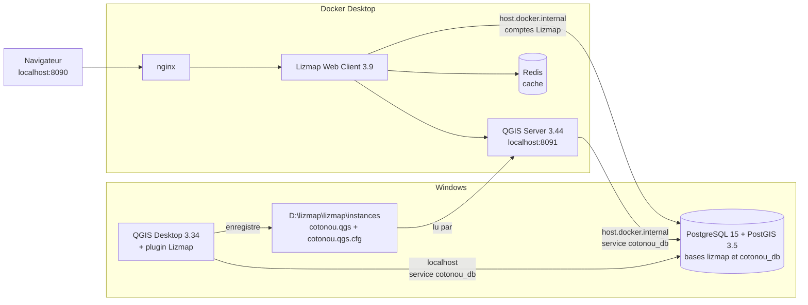

# Lizmap sur le PostgreSQL/PostGIS de Windows

Publier des cartes QGIS sur le web avec **Lizmap** (dans Docker) en gardant le **PostgreSQL/PostGIS
déjà installé sur Windows**, sans deuxième base dans un conteneur.

Tutoriel complet et scripts, de l'installation à une carte en ligne de Cotonou (Bénin) :
inondations, équipements publics, littoral, îlots de chaleur, espaces verts et population.



## Ce que fait ce dépôt

- installe **Lizmap Web Client 3.9 + QGIS Server 3.44** avec le dépôt officiel
  [3liz/lizmap-docker-compose](https://github.com/3liz/lizmap-docker-compose), branché sur le PostgreSQL de Windows ;
- crée un rôle PostgreSQL `lizmap` **en lecture seule** sur les bases publiées ;
- utilise des **services PostgreSQL** pour qu'un même projet QGIS fonctionne dans QGIS Desktop
  (`localhost`) et dans QGIS Server (`host.docker.internal`), sans mot de passe dans le projet ;
- construit en PyQGIS un projet de 12 couches PostGIS prêt pour Lizmap, puis le configure avec le
  plugin Lizmap ;
- liste **tout ce que Docker télécharge** (images, versions, empreintes) et comment le figer.

## Architecture



Les ports 8090 et 8091 ne sont ouverts que sur `127.0.0.1` : rien n'est exposé sur le réseau.

## Versions testées

| | Version |
|---|---|
| Windows | 11 Pro |
| Docker Desktop | Engine 29.9.3, Compose 5.7.0 |
| PostgreSQL / PostGIS | 15.10 / 3.5.0 (service Windows) |
| QGIS Desktop | 3.34.12 LTR, plugin Lizmap 5.0.4 |
| Lizmap Web Client | 3.9.12 (`3liz/lizmap-web-client:3.9`) |
| QGIS Server | 3.44.15 (`3liz/qgis-map-server:3.44`), plugin Lizmap server 2.15.5 |

## Démarrage rapide

Prérequis : Docker Desktop, PostgreSQL + PostGIS, QGIS, Git, et le mot de passe du superutilisateur
`postgres` dans `%APPDATA%\postgresql\pgpass.conf` ([détails](docs/01-installation.md#0-prérequis)).

Dans PowerShell, récupérer ce dépôt (ailleurs que dans `D:\lizmap`, réservé à l'installation de Lizmap) :

```powershell
git clone https://github.com/jauresmas/lizmap.git lizmap-tuto
cd lizmap-tuto
```

Si le dépôt a été téléchargé en ZIP, débloquer les scripts :

```powershell
Get-ChildItem -Recurse .\scripts\*.ps1 | Unblock-File
```

```powershell
.\scripts\diagnostic-poste.ps1
```

```powershell
.\scripts\installer-lizmap.ps1 -Dossier D:\lizmap
```

Se connecter sur http://localhost:8090 (`admin` / `admin`) et changer le mot de passe, puis :

```powershell
.\scripts\publier-base.ps1 -Base cotonou_db
```

```powershell
.\scripts\creer-repertoire-lizmap.ps1 -Cle cotonou -Libelle "Cotonou" -Public
```

Dans la console Python de QGIS : [`pyqgis/creer_projet_cotonou.py`](pyqgis/creer_projet_cotonou.py),
ouvrir le projet créé, déclarer le serveur dans le plugin Lizmap, puis
[`pyqgis/configurer_lizmap.py`](pyqgis/configurer_lizmap.py).

La carte : http://localhost:8090/index.php/view/map?repository=cotonou&project=cotonou

## Le tutoriel

1. [Installer Lizmap sur le PostGIS de Windows](docs/01-installation.md)
2. [Ce que Docker télécharge](docs/02-images-docker.md) : images, versions, empreintes, mise à jour, copie hors ligne
3. [Publier une base PostGIS](docs/03-publier-une-base.md) : rôle en lecture seule, services PostgreSQL, répertoire Lizmap
4. [Le projet QGIS](docs/04-projet-qgis.md) : les règles pour un projet qui passe bien dans Lizmap
5. [Configurer le projet avec le plugin Lizmap](docs/05-configurer-lizmap.md)
6. [Ajouter des couches à un projet publié](docs/06-ajouter-des-couches.md) : îlots de chaleur et littoral
7. [Dépannage](docs/07-depannage.md) : tous les problèmes rencontrés et leur solution

## Contenu du dépôt

```text
├── docker/
│   ├── .env.example                     versions et ports (devient D:\lizmap\.env)
│   └── docker-compose.override.yml      retire le conteneur PostGIS du dépôt officiel
├── config/                              modèles des fichiers de connexion (sans secret)
│   ├── pg_service.conteneurs.conf.example
│   ├── pg_service.desktop.conf.example
│   └── lizmap_local.ini.php.example
├── sql/
│   ├── 01-role-et-base-lizmap.sql       rôle et base "lizmap"
│   └── 02-droits-lecture-lizmap.sql     lecture seule sur une base publiée
├── scripts/                             PowerShell 5.1+
│   ├── diagnostic-poste.ps1             état des lieux, sans rien modifier
│   ├── installer-lizmap.ps1             installation complète
│   ├── publier-base.ps1                 droits + services PostgreSQL des deux côtés
│   └── creer-repertoire-lizmap.ps1      répertoire Lizmap et ses droits
├── pyqgis/
│   ├── creer_projet_cotonou.py          projet QGIS de 12 couches, styles, réglages serveur
│   └── configurer_lizmap.py             remplit le plugin Lizmap et génère le .cfg
└── docs/                                le tutoriel
```

## Sécurité

- aucun mot de passe dans ce dépôt : les fichiers qui en contiennent (`.env`, `pg_service.conf`,
  `*.ini.php`) sont exclus par le [`.gitignore`](.gitignore), seuls leurs modèles `*.example` sont versionnés ;
- le mot de passe du rôle `lizmap` est généré au hasard par le script d'installation et n'est jamais affiché ;
- le rôle `lizmap` ne peut que **lire** les bases publiées ;
- Lizmap et QGIS Server n'écoutent que sur `127.0.0.1`. Pour une mise en ligne réelle, il faudra un
  nom de domaine, HTTPS et un mot de passe administrateur solide.

## Données

La base `cotonou_db` n'est pas fournie : les scripts montrent la démarche sur ces données, à adapter
aux vôtres (noms de tables, styles, alias). Fond de carte © contributeurs
[OpenStreetMap](https://www.openstreetmap.org/copyright).

## Crédits

- [Lizmap](https://www.lizmap.com/), [lizmap-docker-compose](https://github.com/3liz/lizmap-docker-compose)
  et les plugins QGIS Server Lizmap, atlasprint et wfsOutputExtension : [3Liz](https://www.3liz.com/)
- [QGIS](https://qgis.org/), [PostgreSQL](https://www.postgresql.org/), [PostGIS](https://postgis.net/)

## Licence

Les scripts et la documentation de ce dépôt sont sous licence [MIT](LICENSE). Lizmap, QGIS et les
images Docker utilisées gardent leurs propres licences.
