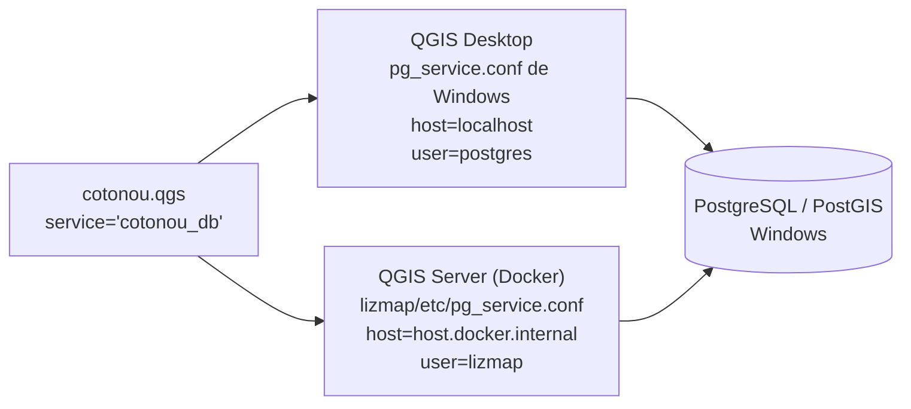

# 3. Publier une base PostGIS

[Sommaire](../README.md) · Précédent : [2. Ce que Docker télécharge](02-images-docker.md) · Suivant : [4. Le projet QGIS](04-projet-qgis.md)

## Le problème à résoudre

Un même projet QGIS est ouvert à deux endroits :

| Qui ouvre le projet | Où est PostgreSQL pour lui | Avec quel compte |
|---|---|---|
| QGIS Desktop (Windows) | `localhost` | votre compte habituel (`postgres` ici) |
| QGIS Server (conteneur) | `host.docker.internal` (`localhost` serait le conteneur lui-même) | `lizmap`, en lecture seule |

Si le projet contient `host=localhost user=postgres`, il marche dans QGIS Desktop et casse dans Lizmap.

## La solution : les services PostgreSQL

Le projet ne contient **que le nom d'un service** : `service='cotonou_db'`. Chaque côté a son propre
fichier `pg_service.conf` qui dit ce que ce nom veut dire :



Bonus : aucun mot de passe ni nom de machine dans le projet, que l'on peut donc partager.

## Le script

```powershell
.\scripts\publier-base.ps1 -Base cotonou_db
```

Il peut être relancé sans risque. Ce qu'il fait :

### 1. Donner le droit de lecture au rôle `lizmap`

[`sql/02-droits-lecture-lizmap.sql`](../sql/02-droits-lecture-lizmap.sql), exécuté sur la base :
`CONNECT` sur la base, `USAGE` sur chaque schéma métier, `SELECT` sur toutes leurs tables. Puis un contrôle :

```text
 tables_lisibles | tables_modifiables
-----------------+--------------------
              59 |                  0
```

(tables, vues et vues matérialisées de tous les schémas, `public` compris ; `0` modifiable : lecture seule.)

> Les droits portent sur les tables **existantes**. Après avoir créé de nouvelles tables, relancer
> le script (ou le fichier SQL).

### 2. Déclarer le service côté conteneurs

Ajout dans `D:\lizmap\lizmap\etc\pg_service.conf` (le mot de passe est repris de la section `[lizmap_local]`) :

```ini
[cotonou_db]
host=host.docker.internal
port=5432
dbname=cotonou_db
user=lizmap
password=...
```

### 3. Déclarer le même service côté QGIS Desktop

QGIS Desktop lit le fichier désigné par la variable d'environnement `PGSERVICEFILE`, sinon
`%APPDATA%\postgresql\.pg_service.conf`. Le script ajoute :

```ini
[cotonou_db]
host=localhost
port=5432
dbname=cotonou_db
user=postgres
```

Pas de mot de passe ici : il est lu dans `pgpass.conf` (ou demandé par QGIS). Pour un autre compte :
`-UtilisateurDesktop mon_compte`. Modèle : [pg_service.desktop.conf.example](../config/pg_service.desktop.conf.example).

> QGIS ne relit `PGSERVICEFILE` qu'au démarrage : si la variable vient d'être créée, redémarrer QGIS.

### 4. Tester les deux côtés

- côté Windows : `psql -d "service=cotonou_db"` ;
- côté conteneur : redémarrage de QGIS Server (`docker compose restart map`, pour relire
  `pg_service.conf`) puis connexion par le service depuis le Python de QGIS Server.

Résultat attendu :

```text
==> Test côté QGIS Desktop
OK : postgres@cotonou_db

==> Redémarrage de QGIS Server et test côté conteneurs
OK : lizmap@cotonou_db - 246 tables visibles
```

(QGIS ne compte pas les mêmes objets que le contrôle SQL : ce qui importe est la ligne
`OK : lizmap@cotonou_db`, preuve que QGIS Server se connecte avec le rôle `lizmap`.)

## Créer le répertoire Lizmap

Dans Lizmap, un **répertoire** est un dossier de projets avec ses droits. Ici `cotonou`, lisible par
tous, y compris les visiteurs non connectés :

```powershell
.\scripts\creer-repertoire-lizmap.ps1 -Cle cotonou -Libelle "Cotonou" -Public
```

Le script :

- crée `D:\lizmap\lizmap\instances\cotonou` ;
- déclare le répertoire (`php console.php repository:create`), ce qui écrit dans
  `lizmap\var\lizmap-config\lizmapConfig.ini.php` :

  ```ini
  [repository:cotonou]
  label=Cotonou
  path="/srv/projects/cotonou/"
  allowUserDefinedThemes=on
  ```

- donne les droits (`php console.php acl2:add`) :

| Droit | Groupes |
|---|---|
| `lizmap.repositories.view` (voir les projets) | anonymes (avec `-Public`), users, publishers, admins |
| `lizmap.tools.layer.export` (exporter les données) | users, publishers, admins |
| `lizmap.tools.displayGetCapabilitiesLinks` (liens WMS/WFS) | admins |

La même chose se fait à la souris : *Administration > Cartes > Ajouter un répertoire*.

Suivant : [4. Le projet QGIS](04-projet-qgis.md)
