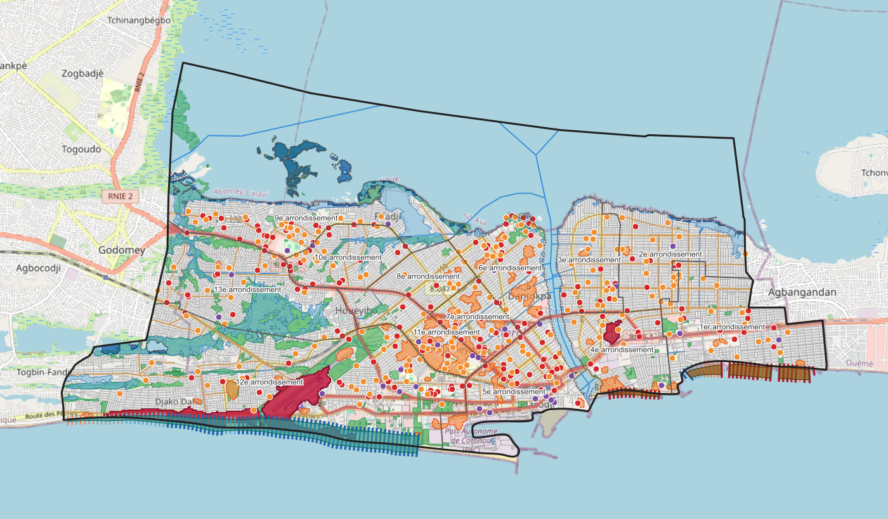

# 4. Le projet QGIS

[Sommaire](../README.md) · Précédent : [3. Publier une base](03-publier-une-base.md) · Suivant : [5. Configurer Lizmap](05-configurer-lizmap.md)



## Les couches

12 couches de la base `cotonou_db` (SCR des tables : EPSG:32631, UTM 31N) et un fond OpenStreetMap.

| Groupe | Couche | Table | Géométrie | Entités | Style |
|---|---|---|---|---:|---|
| Référentiel | Limite communale | `referentiel.limite_communale` | polygone | 1 | contour noir |
| | Arrondissements | `referentiel.arrondissements` | multipolygone | 13 | tirets gris + étiquettes |
| Équipements publics | Équipements | `equipements.equipements` | point | 399 | par thème : éducation, santé, sécurité et services |
| Risques | Zones inondables | `inondations.zones` | polygone | 137 | exposition forte / probable (bleus) |
| Littoral | Surfaces gagnées / perdues (1986-2026) | `littoral.surfaces` | multipolygone | 3 | gagné (vert d'eau) / perdu (brun) |
| | Évolution du trait de côte (transects) | `littoral.transects` | ligne | 131 | 5 classes de recul / avancée |
| | Traits de côte 1984-2026 *(masquée)* | `littoral.rivages` | multiligne | 20 | dégradé par année |
| Chaleur urbaine | Îlots de chaleur | `chaleur.ilots` | polygone | 47 | îlot (orange) / intense (bordeaux) |
| Environnement | Espaces verts | `vegetation.espaces_verts` | multipolygone | 288 | vert |
| | Densité de population 2025 (hab/km²) *(masquée)* | `population.hexagones` | polygone | 1 488 | quintiles jaune → rouge |
| Fond de plan | Voirie | `fond.voirie` | multiligne | 5 577 | 3 niveaux de voies |
| | Cours d'eau | `fond.cours_eau` | multiligne | 290 | bleu |
| baselayers | OpenStreetMap | tuiles XYZ | | | |

*(masquée)* : présente dans la carte mais décochée à l'ouverture.

## Les règles pour un projet qui passe bien dans Lizmap

### 1. Couches PostgreSQL par service

*Gestionnaire des sources de données > PostgreSQL > Nouveau* : renseigner **seulement** le champ
*Service* (`cotonou_db`), laisser hôte, port, base et identifiants vides.

Vérifier dans *Propriétés de la couche > Information* : la source commence par `service='cotonou_db'`
et ne contient ni `host=` ni `user=`.

### 2. SCR du projet : EPSG:3857

Le fond OpenStreetMap est en EPSG:3857 (Pseudo-Mercator) : le projet aussi, sinon Lizmap
reprojette les tuiles et le rendu se dégrade.

> **Piège** : quand on ajoute une première couche à un projet vide, QGIS adopte son SCR (ici 32631).
> Fixer le SCR du projet **après** avoir ajouté les couches, et vérifier en bas à droite de la fenêtre.

### 3. Arbre des couches

- un groupe nommé `baselayers` à la racine : Lizmap en fait la liste des **fonds de carte** ;
- **jamais un groupe et une couche du même nom** : les noms WMS entrent en conflit et la couche
  disparaît de Lizmap (d'où « Équipements publics » pour le groupe et « Équipements » pour la couche) ;
- ce qui est coché dans QGIS est affiché à l'ouverture dans Lizmap.

### 4. Champs : alias et champs techniques masqués

Pour les popups et les tables attributaires :

- *Propriétés de la couche > Champs* : renseigner un **alias** lisible (« Bâtiments exposés » plutôt
  que `batiments`) ;
- pour les identifiants et colonnes techniques (`gid`, `osm_id`, `source`...), cocher dans la colonne
  *Configuration* : **Masquer dans WMS**.

> Le widget « Caché » du formulaire ne suffit pas : il masque le champ dans QGIS Desktop, mais la
> popup de Lizmap (requête WMS `GetFeatureInfo`) l'affiche encore. C'est l'option
> *Masquer dans WMS* qui compte. Le script fait les deux.

### 5. Propriétés du projet

| Où | Réglage |
|---|---|
| *Général* | Titre : « Cotonou - risques et équipements » (c'est le titre affiché par Lizmap) |
| *Sources de données* | cocher *Faire confiance au projet quand la source n'a pas de métadonnées* |
| *QGIS Server > Capacités du service* | cocher, renseigner titre, résumé, mots-clés |
| *QGIS Server > WMS* | *Emprise annoncée* : la commune + 8 % ; *Ajouter la géométrie à la réponse* ; *Utiliser les paramètres du formulaire d'attributs pour GetFeatureInfo* |
| *QGIS Server > WFS* | publier les 12 couches, précision 6 |

### 6. Côté couches PostgreSQL

Deux réglages que le plugin Lizmap vérifie (il propose aussi de les corriger, voir le chapitre suivant) :

- `estimatedmetadata=true` dans la source : QGIS lit l'emprise et le nombre d'entités dans les
  statistiques de PostgreSQL au lieu de parcourir les tables, d'où une ouverture bien plus rapide ;
- *Propriétés > Rendu* : décocher la **simplification côté fournisseur** (bloquant pour le plugin).

### 7. Enregistrer au format `.qgs`

Lizmap lit les projets **`.qgs`** (pas `.qgz`), dans le dossier du répertoire :
`D:\lizmap\lizmap\instances\cotonou\cotonou.qgs`.

Une image `cotonou.qgs.png` (400 × 300) à côté du projet sert de vignette sur la page d'accueil de Lizmap.

## Le script

[`pyqgis/creer_projet_cotonou.py`](../pyqgis/creer_projet_cotonou.py) applique tout ce qui précède :
couches, styles, alias, champs masqués, groupes, SCR, réglages QGIS Server, vignette.

Dans la *Console Python* de QGIS (*Extensions > Console Python*) :

```python
exec(open(r"C:\chemin\vers\lizmap-tuto\pyqgis\creer_projet_cotonou.py", encoding="utf8").read())
```

Il construit le projet dans une instance séparée (le projet ouvert n'est pas modifié) et l'écrit dans
le chemin `SORTIE` défini en tête de fichier :

```text
Projet écrit : D:\lizmap\lizmap\instances\cotonou\cotonou.qgs
12 couches PostGIS + OpenStreetMap - SCR EPSG:3857
  Limite communale                                    ? entités
  Arrondissements                                    13 entités
  Équipements                                       399 entités
  ...
```

Un `?` signifie que PostgreSQL n'a pas encore de statistiques sur la table (`ANALYZE` les crée) :
sans conséquence.

Ensuite : *Projet > Ouvrir* `cotonou.qgs`, puis [configurer Lizmap](05-configurer-lizmap.md).

> Relancer le script **remplace** le projet et change les identifiants internes des couches : refaire
> ensuite la configuration Lizmap (le script du chapitre 5 la reconstruit entièrement).

Pour vos propres données, garder la structure du script et remplacer les appels `couche(...)`,
les styles et les alias.

### Avec le MCP de QGIS

Ce tutoriel a été réalisé en pilotant QGIS depuis un assistant (Claude Code) grâce au plugin
[QGIS MCP](https://github.com/jjsantos01/qgis_mcp) : ses outils `execute_code` et `render_map`
exécutent du Python dans QGIS et en renvoient le résultat. Le contenu de `pyqgis/` est ce qui a été
exécuté, remis au propre. Le plugin n'accepte **qu'un client à la fois** : si un autre outil y est
connecté, *Stop Server* puis *Start Server* dans son panneau.

Suivant : [5. Configurer Lizmap](05-configurer-lizmap.md)
