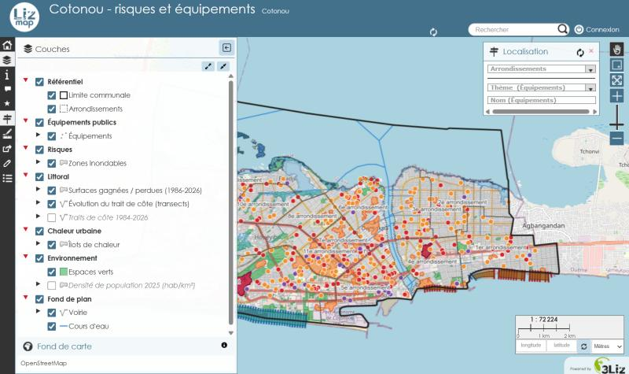

# 5. Configurer le projet avec le plugin Lizmap

[Sommaire](../README.md) · Précédent : [4. Le projet QGIS](04-projet-qgis.md) · Suivant : [6. Ajouter des couches](06-ajouter-des-couches.md)

Le plugin Lizmap de QGIS Desktop écrit, à côté du projet, le fichier **`cotonou.qgs.cfg`** (JSON) :
outils de la carte, popups, tables attributaires, recherche... Sans ce fichier, Lizmap n'affiche pas le projet.

Le projet `cotonou.qgs` doit être ouvert dans QGIS.

## 1. Déclarer le serveur Lizmap

*Extensions > Lizmap > Lizmap*, panneau **Information**, bouton *Ajout du premier serveur* (ou *+*) :

- URL : `http://localhost:8090/`
- identifiant `admin` et le mot de passe choisi à la première connexion (rangé dans le gestionnaire
  d'authentification de QGIS, pas dans le projet).

Le plugin interroge le serveur et affiche ses versions (Lizmap 3.9.12, QGIS Server 3.44.15). Il
refuse de générer le `.cfg` tant qu'aucun serveur n'est déclaré avec un compte administrateur.

## 2. Mode « Normal » et mesures de protection

Panneau **Paramètres** :

- choisir le mode **Normal** au lieu de **Débutant**. Le mode débutant impose toutes les mesures de
  protection, dont l'interdiction des fichiers de service PostgreSQL (utile chez certains
  hébergeurs, pas ici) : le projet serait refusé ;
- groupe *Mesure de protection* : décocher
  **Prévenir les couches PostgreSQL d'utiliser un fichier de service**.

## 3. Les panneaux remplis

| Panneau | Réglages |
|---|---|
| Information | serveur `http://localhost:8090/`, répertoire cible `cotonou` |
| Options de carte | échelles natives 1:1 000 → 1:250 000 ; emprise initiale = emprise annoncée (WMS) ; historique des zooms, mesure, dessin, permalien automatique ; recherche d'adresse Nominatim ; popups regroupées par couche |
| Couches | popup (source *auto*) sur 9 couches, avec un résumé ; la visibilité au démarrage reprend celle de QGIS |
| Fond de carte | OpenStreetMap (du groupe `baselayers`) |
| Table d'attributaire & sélection | Équipements, Zones inondables, Îlots de chaleur, Évolution du trait de côte, Espaces verts, Arrondissements (clé `gid`, export autorisé, champs masqués repris du projet) |
| Localiser par couche | Arrondissements (champ `nom`, zoom sur la géométrie) ; Équipements (champ `nom`, filtre par `theme`, 2 caractères minimum) |

La popup *auto* affiche les champs avec leurs **alias** et sans ceux marqués *Masquer dans WMS*
au [chapitre 4](04-projet-qgis.md#4-champs--alias-et-champs-techniques-masqués).

## 4. Vérifications et corrections automatiques

Le panneau **Contrôles** (bouton *Vérifier*) liste les problèmes du projet ; le panneau
**Outils d'auto-correction** les corrige. Trois sont apparus ici :

| Problème | Gravité | Correction |
|---|---|---|
| simplification des géométries côté fournisseur | **bloquant** | désactivée sur toutes les couches |
| couches PostgreSQL sans `estimatedmetadata=true` | recommandation | ajouté dans les sources |
| projet non « de confiance » | recommandation | option cochée dans le projet |

## 5. Enregistrer

Bouton *Appliquer* : le plugin enregistre le projet et écrit `cotonou.qgs.cfg`. Au passage, il donne
à chaque couche un **nom court** sans accents ni espaces : c'est son nom WMS, utilisé dans les URL.

```text
D:\lizmap\lizmap\instances\cotonou\
├── cotonou.qgs          projet QGIS
├── cotonou.qgs.cfg      configuration Lizmap (plugin 5.0.4, cible Lizmap 3.9)
└── cotonou.qgs.png      vignette de la page d'accueil
```

## Le script

[`pyqgis/configurer_lizmap.py`](../pyqgis/configurer_lizmap.py) fait les étapes 2 à 5 sans clic.
Le serveur doit être déclaré (étape 1) et le projet ouvert. Dans la console Python de QGIS :

```python
exec(open(r"C:\chemin\vers\lizmap-tuto\pyqgis\configurer_lizmap.py", encoding="utf8").read())
```

```text
Ouverture du plugin Lizmap...
cotonou.qgs.cfg enregistré
  popups : 9 | tables : 6 | localiser : 2
```

> Le script passe par l'intérieur du plugin (noms des cases de la fenêtre, gestionnaires de
> tables), qui n'est pas une interface stable. Testé avec QGIS 3.34.12 et le plugin 5.0.4 ; avec une
> autre version, préférer la méthode à la souris.

La fenêtre du plugin est *modale* (elle bloque QGIS tant qu'elle est ouverte) : le script l'ouvre
puis la remplit à l'aide de minuteries (`QTimer`), sans quoi la console attendrait sa fermeture.

## Résultat

http://localhost:8090/index.php/view/map?repository=cotonou&project=cotonou



À vérifier :

- les 12 couches dans la légende, regroupées comme dans QGIS ;
- un clic sur un équipement : popup avec « Nom », « Thème », « Quartier »... et sans `gid` ni `sources` ;
- *Données* : les 6 tables attributaires et leur export ;
- *Localiser* : liste des arrondissements, recherche d'un équipement par son nom.

## Republier après une modification

Modifier le projet dans QGIS, *Enregistrer*, puis rouvrir le plugin Lizmap et *Appliquer* : le
`.cfg` est réécrit. QGIS Server recharge le projet tout seul (il surveille la date du fichier).
Recharger la page dans le navigateur.

Suivant : [6. Ajouter des couches](06-ajouter-des-couches.md)
